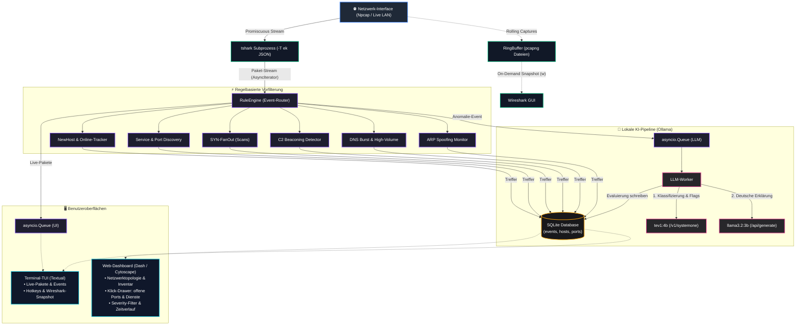

# 👁️ Glubschauge

> **Netzwerk-Monitor mit lokaler KI, TUI und Web-Dashboard**

**Glubschauge** überwacht passiv den Datenverkehr im lokalen Netzwerk in Echtzeit. Es kombiniert eine leichtgewichtige, regelbasierte Paket- und Anomalie-Erkennung mit **lokalen Sprachmodellen (via Ollama)**, um erkannte Vorfälle ohne Cloud-Abhängigkeit präzise zu bewerten und verständlich zu erklären.

Das System bietet sowohl eine **Terminal-Benutzeroberfläche (TUI)** als auch ein modernes **Web-Dashboard** mit interaktiver Netzwerktopologie und Inventarverwaltung.

---

## ✨ Features

- **Live-Paketanalyse:** Liest Pakete direkt aus `tshark` (Wireshark) mit konfigurierbarem BPF-Filter.
- **Regelbasierte Detektoren (Vorfilterung):**
  - `NewHostDetector`: Erkennt neue physische Geräte im LAN und pflegt Online-/Idle-Stati.
  - `ServiceDiscoveryDetector`: Erkennt passiv lauschende Dienste und offene Ports anhand von Server-Antworten (SYN+ACK, UDP).
  - `SynFanOutDetector` & `SynFanOutMultiDetector`: Identifiziert Port-Scans und laterale Netzwerk-Scans.
  - `BeaconingDetector`: Erkennt regelmäßige Kommunikationsmuster (z. B. C2-Server-Verbindungen).
  - `DnsFailureDetector`: Schlägt Alarm bei auffälligen DNS-Fehler-Bursts.
  - `HighVolumeFlowDetector`: Überwacht ungewöhnlich hohe Datenübertragungsraten.
  - `ArpSpoofDetector`: Schützt vor ARP-Poisoning und Man-in-the-Middle-Angriffen.
- **Lokale KI-Bewertung (Hybrid-Pipeline via Ollama):**
  - **Entscheider-Modell (`tev1:4b`):** Ermittelt über `/v1/systemone` strukturierte Wahrscheinlichkeiten (z. B. Scan, externes C2).
  - **Erklärer-Modell (`llama3.2:3b`):** Generiert kurze, präzise deutsche Erklärungen zu Vorfällen.
  - **Auto-Eskalation:** Manuelle Tiefenanalyse mit größeren Modellen (`llama3.1:8b`, `qwen2.5-coder:14b`).
- **Rotierender PCAP-Ringpuffer:** Schreibt im Hintergrund rotierende Capture-Dateien. Per Tastendruck öffnet sich der Vorfall direkt als Snapshot in **Wireshark**.
- **Modernes Dash-Web-Dashboard:**
  - **Übersicht:** KPIs, Schweregrad-Verteilung, Event-Feed und Zeitverlauf.
  - **Hosts & Topologie:** Interaktiver Cytoscape-Graph mit Online-Status (Grün/Gelb/Grau) und Klick-Drawer für offene Ports, Dienste und Details.
  - **Events & Reports:** Volltextsuche, Severity-Filter und Markdown-Export.

---

## 🏗️ Architektur



---

## 📋 Voraussetzungen

1. **Python 3.11+**
2. **Wireshark / tshark:** Muss installiert sein (z. B. `C:\Program Files\Wireshark\tshark.exe` oder `M:\Wireshark\tshark.exe`).
3. **Npcap:** Für Live-Captures unter Windows.
4. **Ollama:** Lokal installiert und laufend (`http://localhost:11434`).
   ```bash
   ollama pull llama3.2:3b
   ollama pull tev1:4b

🚀 Installation & Start
1. Repository klonen & Abhängigkeiten installieren
code Bash

git clone https://github.com/dein-user/glubschauge.git
cd glubschauge

# Virtuelle Umgebung erstellen
python -m venv .venv
.venv\Scripts\activate   # Windows
# source .venv/bin/activate # Linux/macOS

# Pakete installieren
pip install -r requirements.txt

(Falls keine requirements.txt vorhanden ist: pip install textual dash dash-bootstrap-components dash-cytoscape dash-bootstrap-templates plotly pandas httpx pydantic)
2. Konfiguration anpassen (config.toml)

Passe Pfade, Netzwerkkarte und Subnetze an:
code Toml

[capture]
tshark_path = "M:\\Wireshark\\tshark.exe"
interface   = "8"                           # Interface-ID oder Name
bpf_filter  = "not port 22 and not port 21027"

[network]
local_subnets = ["192.168.0.0/24"]
trusted_hosts = [
  "00:cb:7a:50:16:c4",                      # Eigene bekannte MAC-Adressen
]

[llm]
decision_mode     = true
decision_model    = "tev1:4b"
explanation_model = "llama3.2:3b"

    Tipp: Führe tshark -D im Terminal aus, um die Nummer deines Netzwerk-Interfaces herauszufinden.

3. Anwendung starten

Terminal-TUI:
code Bash

python run.py

Web-Dashboard (parallel startbar):
code Bash

python dashboard/app.py

Öffne anschließend http://127.0.0.1:8050 im Browser.
⌨️ Tastenbelegung in der TUI

Taste	Aktion	Beschreibung

d	Details	Zeigt vollständige Details und LLM-Erklärung zum markierten Event

Esc	Schließen	Schließt das Detail-Panel
w	Wireshark	Öffnet den pcap-Snapshot des Events direkt in Wireshark
h	Hosts / Pakete	Schaltet das linke Panel zwischen Live-Paketen und Host-Inventar um
s	Filter	Schaltet den minimalen Severity-Filter zyklisch durch (0, 2, 3, 5, 7, 8)

r	Re-Analyse	Wiederholt die LLM-Bewertung mit Standardmodell (llama3.1:8b)

R	Tiefenanalyse	Führt forensische Re-Analyse durch (qwen2.5-coder:14b)

e	Export	Schreibt gefilterte Events als Markdown-Report in /reports

c	Leeren	Leert die Tabellenansicht (Datenbank bleibt erhalten)

q	Beenden	Beendet glubschauge und stoppt Hintergrund-Captures


## 📁 Projektstruktur

```mermaid
graph TD
    classDef root fill:#312e81,stroke:#6366f1,stroke-width:2px,color:#fff;
    classDef dir fill:#1e293b,stroke:#0ea5e9,stroke-width:2px,color:#fff;
    classDef file fill:#18181b,stroke:#64748b,stroke-width:1px,color:#e2e8f0;

    Root["📂 glubschauge/"]:::root

    %% Root files
    Root --> Cfg["📄 config.toml (Zentrale Einstellungen)"]:::file
    Root --> Run["▶️ run.py (Einstiegspunkt TUI)"]:::file

    %% Glubschauge Core
    Root --> CoreDir["📂 glubschauge/ (Kern-Engine)"]:::dir
    CoreDir --> C_Cap["capture.py (tshark Subprozess)"]:::file
    CoreDir --> C_Eng["engine.py (RuleEngine & Queues)"]:::file
    CoreDir --> C_Det["detectors.py (7 Detektoren & Porterkennung)"]:::file
    CoreDir --> C_Evt["events.py (SQLite EventStore)"]:::file
    CoreDir --> C_Wrk["worker.py (Async LLM-Worker)"]:::file
    CoreDir --> C_Bro["broker.py (Prompts & Entscheidungslogik)"]:::file
    CoreDir --> C_Llm["llm.py (Ollama Client)"]:::file
    CoreDir --> C_Rng["ringbuffer.py (Pcap-Rotator)"]:::file
    CoreDir --> C_Tui["tui.py (Textual Benutzeroberfläche)"]:::file
    CoreDir --> C_Oui["oui.py (MAC-Vendor-Lookup)"]:::file

    %% Dashboard
    Root --> DashDir["📂 dashboard/ (Web-Oberfläche)"]:::dir
    DashDir --> D_App["app.py (Plotly Dash Server)"]:::file
    DashDir --> D_Dat["data.py (SQL-Abfragen & Topologie-Graph)"]:::file
    
    DashDir --> PagesDir["📂 pages/ (Webseiten)"]:::dir
    PagesDir --> P_Ovw["overview.py (KPIs & Zeitverlauf)"]:::file
    PagesDir --> P_Hst["hosts.py (Topologie & Port-Drawer)"]:::file
    PagesDir --> P_Evt["events.py (Filter & Volltextsuche)"]:::file
    PagesDir --> P_Rep["reports.py (Export-Viewer)"]:::file

    DashDir --> CompDir["📂 components/ (UI-Elemente)"]:::dir
    CompDir --> CP_Inv["host_inventory.py (Inventar-Tabelle)"]:::file
    CompDir --> CP_Evt["event_feed.py (Live-Tabelle)"]:::file
    CompDir --> CP_Kpi["kpi_cards.py (Status-Karten)"]:::file

    %% Reports & Tests
    Root --> RepDir["📂 reports/ (Markdown Exporte)"]:::dir
    Root --> RingDir["📂 ring/ (Pcapng Ringbuffer-Dateien)"]:::dir
```



🔒 Datenschutz & Sicherheit

    100 % Lokal: Es werden keinerlei Telemetriedaten oder Netzwerk-Payloads an externe Server gesendet. Alle Auswertungen laufen auf deiner eigenen Hardware via Ollama.

    Passiv: glubschauge agiert primär als passiver Sniffer und sendet standardmäßig keine störenden Netzwerk-Scans durch dein LAN.

📄 Lizenz

MIT License — Siehe LICENSE für Details.